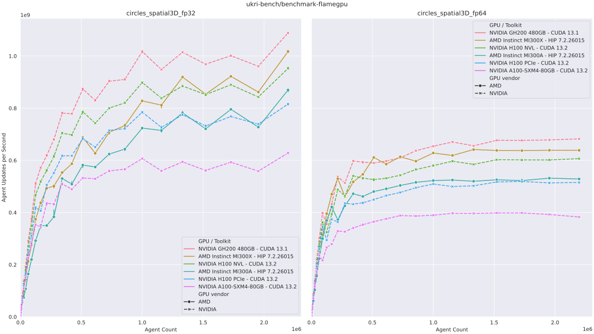

# FLAMEGPU benchmark

This repository provides a set of performance benchmarks of [FLAME GPU 2](https://github.com/FLAMEGPU/FLAMEGPU2) as part of the [UKRI Living Benchmarks project](https://ukri-bench.github.io/).

FLAME GPU is a GPU accelerated agent-based simulation library for domain independent complex systems simulations, with CUDA/ROCm C++ and Python interfaces.
Agent Based Models (ABM) come in many shapes and simulations can have vastly different scales, which may have different performance characteristics.

This repository includes multiple agent based models benchmarked at a range of simulation scales (each repeated `3` times by default):

- `circles_spatial3D_fp32`
  - The [*circles* scalable benchmark model][chisholm2017standardised], a point-based 3D model with local spatial communication using single-precision (FP32).
- `circles_spatial3D_fp64`
  - The [*circles* scalable benchmark model][chisholm2017standardised], a point-based 3D model with local spatial communication using double-precision (FP64).
- Additional benchmark models covering a broader range of typical ABM shapes will be added in the future.

The number of agents updates per second (`num_agents` * `num_steps` / `time`) is used as the Figure of Merit (FoM).

## Status

Alpha

## Maintainers

- [Peter Heywood](https://github.com/ptheywood)
- [Robert Chisholm](https://github.com/robadob)
- [Paul Richmond](https://github.com/mondus)

## Overview

### Software

- [FLAME GPU 2](https://github.com/FLAMEGPU/FLAMEGPU2)

### Architectures

- GPU: NVIDIA, AMD

### Languages and programming models

- Programming languages: C++, CUDA, ROCm/HIP
- Accelerator offload models: CUDA, ROCm/HIP

<!-- ### Seven 'dwarfs'

- [ ] Dense linear algebra
- [ ] Sparse linear algebra
- [ ] Spectral methods
- [ ] N-body methods
- [ ] Structured grids
- [ ] Unstructured grids
- [ ] Monte Carlo -->

## Building the benchmark

The benchmark can currently only be built manually via CMake. 

<!-- The benchmark can be built using Spack or manually. If you are using the 
ReFrame method to run the benchmark described below, it will automatically
perform the build step for you.

Once it has been built the benchmark executable is called `name-of-exe.x` -->

<!-- ### Spack build

A Spack package is provided in `spack/`:

```bash
spack repo add ./spack
spack info <package name>
```
- ADD: Describe Spack spec and variants available

Note: to use Spack, you must have Spack installed on the system you are using and
a valid Spack system configuration. Example Spack configurations are available
in a separate repository: [https://github.com/ukri-bench/system-configs] -->

### Manual build

This benchmark is configured as a CMake project and requires:

- Git >= `1.6.6`
- CMake >= `3.25.2`

With either:

- CUDA >= `12.4` with a compatible GCC >= `11` (for c++20 support)
  - Compatible clang installations with c++20 support may work, but are currently untested / not supported by FLAME GPU 2 
- HIP/ROCm >= `7.0` with the included `hipcc`
  - The ROCm CMake modules must be discoverable by `find_package`
  
Several C++/CUDA/HIP libraries are also required, which are fetched via CMake during configuration by default:

- [CLI11](https://github.com/cliutils/cli11)
- [nlohmann/json](https://github.com/nlohmann/json)
- [FLAME GPU 2](https://github.com/FLAMEGPU/FLAMEGPU2) & it's dependencies
  - `>= 2.0.0-rc6` for HIP/ROCm support (once released)

> [!NOTE]
> Older CUDA or HIP/ROCm versions with c++20 support may be used by setting `FLAMEGPU_ALLOW_UNSUPPORTED_COMPILER=ON`, however, compilation errors are likely as this is untested and unsupported.

1. Clone this repository

    ```bash
    git clone https://github.com/ukri-bench/benchmark-flamegpu.git
    ```

2. Configure using `cmake`, with the appropriate compilers and CMake Configuration arguments for the platform (updating `CMAKE_CUDA_ARCHITECTURES` or `CMAKE_HIP_ARCHITECTURES` with the appropriate value for the system):

    For Nvidia GPUs (with Ampere GPUs as the example `CMAKE_CUDA_ARCHITECTURES`)

    ```bash
    cmake -S . -B build -DCMAKE_BUILD_TYPE=Release -DFLAMEGPU_BACKEND=CUDA -DCMAKE_CUDA_ARCHITECTURES=80 -DFLAMEGPU_SEATBELTS=OFF
    ```

    For AMD GPUs (with Mi350x as the example `CMAKE_HIP_ARCHITECTURES`):

    ```bash
    CC=hipcc CXX=hipcc cmake -S . -B build -DCMAKE_BUILD_TYPE=Release -DFLAMEGPU_BACKEND=HIP -DCMAKE_HIP_ARCHITECTURES=gfx942 -DFLAMEGPU_SEATBELTS=OFF
    ```

3. Build the benchmark target(s) using CMake 

    ```bash
    cmake --build build --target all -j `nproc`
    ```

## Running the benchmark

The benchmark must be run manually at this time. 
ReFrame support will be added in the future. 

<!-- The benchmark can be run using ReFrame or manually. 

If you use ReFrame, then ReFrame will build the software, run the benchmark,
test for correctness, extract the performance/figure of merit (FoM) for you and
report them.

### Running using ReFrame

The ReFrame test configuration is available in the `reframe/` subdirectory.

ADD: Instructions on running ReFrame for this benchmark.

Note: to use ReFrame, you must have ReFrame installed on the system you are using and
a valid ReFrame system configuration. Example ReFrame configurations are available
in a separate repository: [https://github.com/ukri-bench/system-configs] -->

### Running manually

A single binary will have been produced within the CMake build directory. For a `Release` build with `build` this would be `build/bin/Release/benchmark-flamegpu`. 

When executed, by default the full set of benchmarks are executed and benchmark data is written to `benchmark-flamegpu.json` in the current working directory (as well as being printed to stdout).
`-o/--output` can be used to write specify an alternate destination for the JSON file output.

Use `-h`/`--help` to see a full list of command line arguments.

```bash
cd build
./bin/Release/benchmark-flamegpu -o output.json
```

`scripts/slurm/` includes example job submission scripts for several HPC systems, built manually using CMake. These are intended to be submit from the directory they are contained within.

- [scripts/slurm/cosma8](scripts/slurm/cosma8/): Durham HPC Hardware Lab (MI300x)
- [scripts/slurm/n8cir-bede](./scripts/slurm/n8cir-bede/): N8 CIR Bede (GH200)
- [scripts/slurm/cosma8/](scripts/slurm/cosma8/): The University of Sheffield Stanage (A100 SXM4, H100 PCIe, H100 NVL)


> [!CAUTION]
> - Todo: Example of how to test correctness

#### Extracting Performance data

The benchmark data JSON is a single JSON object which includes 2 top-level members `benchmarks` and `metadata`.

The `metadata` object contains relevant `build` and `runtime` metadata in separate JSON objects, where `metadata.build` includes:

| Field | Description |
|-------|-------------|
| `BUILD_TYPE` | The `CMAKE_BUILD_TYPE`. This should be `Release` for benchmark runs. |
| `FLAMEGPU_SEATBELTS` | If the `FLAMEGPU_SEATBELTS` runtime checks were enabled. This is typically disabled for benchmark runs. |
| `FLAMEGPU_VERSION` | The `FLAMEGPU_VERSION` value, e.g. `2.0.0-rc.6+4fa74199` |
| `git_describe` | The result of `git describe --always --dirty` for this repository from the most recent cmake configuration step |
| `gpu_toolkit` | The GPU toolkit used for this build, e.g. `HIP 7.2.26015` or `CUDA 13.2` |

And `metadata.runtime` includes:

| Field | Description |
|-------|-------------|
| `cpu_model_name` | The CPU model name from `/proc/cpuinfo` if available |
| `gpu_driver` | The GPU driver version via `RMSI`/`NVML` |
| `gpu_idx` | The GPU index used for this simulation run (within the node) |
| `gpu_name` | The GPU model name reported by HIP/CUDA |


The `benchmarks` object contains an array of simulation parameters and timing data for each named benchmark, where each element in `benchmarks.<model_name>[]` includes:

| Field | Description |
|-------|-------------|
| `agent_count` | The number of agents in the simulation. This has a 1:1 mapping with GPU threads |
| `steps` | The number of simulation steps/iterations executed |
| `seed` | PRNG seed for passed to FLAMEGPU2 |
| `validation` | If validation was enabled for this run |
| Model-specific parameters | Benchmark model specific parameters e.g. `env_width`, `comm_radius` |   
| `s_total` | Time in seconds for this simulation including: model definition/construction, CUDA/HIP context (re)creation, simulation initialisations & simulation execution |
| `s_simulation`| Time in seconds for the call to `simulate` as reported by FLAMEGPU2 | 
| `s_rtc` | Time in seconds for runtime compilation of agent functions reported by FLAMEGPU2. This should be 0 for models currently in this benchmark | 
| `s_init` | Time in seconds for FLAMEGPU_INIT function execution for the model, including agent population generation |
| `s_steps` | Total time for  |
| `s_exit` | Time in seconds for FLAMEGPU_EXIT function execution |
| `agent_updates` | Precomputed value of `agent_count` * `steps` (valid for models which do not change population over time) |
| `agent_updates_per_s_total` | The default figure-of-merit Precomputed value of `agent_updates` / `s_total` | 
| `validation_result` | If the validation check passed (if enabled) |

> [!NOTE]
> Most execution runtimes are captured using [`std::chrono::steady_clock`](https://en.cppreference.com/cpp/chrono/steady_clock), which does not provide any precision or accuracy guaranteed.
>
> `s_steps` is the accumulation of per step/iteration elapsed times, individually captured using either either: HIP/CUDA Event objects in the default stream; or if running under Windows on a WDDM device `std::chrono::steady_clock`. 
> HIP/CUDA Event timers have a documented resolution of ~1us under HIP & ~0.5us under CUDA. Additional error may be introduced during the accumulation of elapsed time in seconds in `double` precision. 

Benchmark data can be plotted using the included plotting script: `scripts/plot.py`. See `-h`/`--help` for full CLI options.

```bash
python -m venv ./scripts/.venv/
source ./scripts/.venv/bin/activate
python -m pip install -r ./scripts/requirements.txt
python ./scripts/plot.py -o output -- output.json
```

## Example performance data

Example performance data from selected HPC systems is included in the [`benchmark-results`](./benchmark-results/) directory.



<!-- python3 scripts/plot.py -o benchmark-results/ --subplots --format svg -- benchmark-results/*.json -->

## License

This benchmark description and associated files are released under the GNU AGPLv3.

## Acknowledgements

### The University of Sheffield

We acknowledge IT Services at The University of Sheffield for the provision of services for High Performance Computing.

### N8 CIR

This work made use of the facilities of the N8 Centre of Excellence in Computationally Intensive Research (N8 CIR) provided and funded by the N8 research partnership and EPSRC (Grant No. EP/T022167/1). The Centre is coordinated by the Universities of Durham, Manchester, and York.

### Dirac@Durham HPC Hardware Lab

This work used the HPC Hardware Lab which is part of the COSMA facility which includes the DiRAC@Durham facility managed by the Institute for Computational Cosmology on behalf of the STFC DiRAC HPC Facility (www.dirac.ac.uk). The equipment was funded by BEIS capital funding via STFC capital grants ST/K00042X/1, ST/P002293/1, ST/R002371/1 and ST/S002502/1, Durham University and STFC operations grant ST/R000832/1. DiRAC is part of the National e-Infrastructure. The HPC Hardware Lab is funded from various sources including the UK ExCALIBUR programme.


<!--  -->

[chisholm2017standardised]: https://doi.org/10.1007/978-3-319-58943-5_25 "Chisholm, R., Richmond, P., Maddock, S. (2017). A Standardised Benchmark for Assessing the Performance of Fixed Radius Near Neighbours. In: Desprez, F., et al. Euro-Par 2016: Parallel Processing Workshops. Euro-Par 2016. Lecture Notes in Computer Science(), vol 10104. Springer, Cham. https://doi.org/10.1007/978-3-319-58943-5_25"
